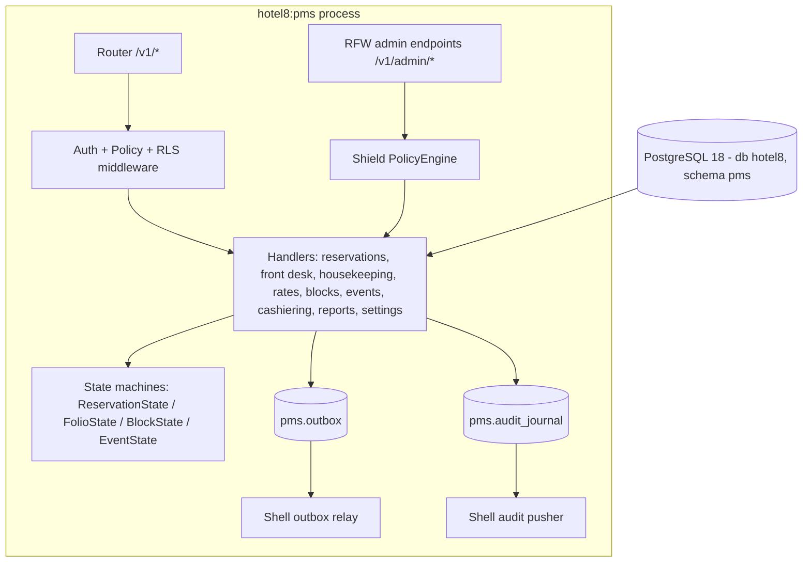

# Hotel8:PMS - Property Management System

## 1. Summary

Hotel8:PMS is the property-management core of the hotel8 vertical: it owns
properties, room inventory, rate plans, reservations, front-desk operations,
housekeeping, cashiering (folios), group blocks, banquet events, and the
nightly end-of-day close. It exposes a public REST surface for channel-facing
guest workloads and an RFW admin surface rendered by Sentin8:Dash, and it is
the platform's canonical issuer of the hospitality domain events the other
hotel8 services (POS, upsell, distrib, meta, loyalty) consume.

## 2. Motivation

A hotel operator needs one system of record that models the physical property
(rooms, types, floors, features), the commercial state (rates, availability,
reservations, folios), and the operating rhythm (housekeeping cycles, night
audit). Third-party property-management systems cannot be extended at the
platform's security posture: tenant-isolated RLS, policy-engine authorization,
and event-first integration. PMS exists so that every hotel8 application
(eguest, ekiosk, epms, epos, ebooking) and every channel integration consumes a
single, consistently-authorized domain model instead of duplicating
reservation logic per surface.

## 3. Architecture & High-Level Design

PMS is a vertical service built on the shared `sentin8-shell` boot: the shell
owns registration, PQ-TLS listener, capped pool, Shield policy engine
boot-load and hot-reload, the outbox relay and the audit-journal pusher. The
component breakdown:

Requests enter through the platform's PQ-TLS ingress with `X-Sentin8-*` context
headers, are verified by Sentin8:Auth's JWKS, authorized by the Shield engine
(`policy::require`, step 5 of the platform pipeline), then set the tenant
context on the pooled connection before touching `pms.*` tables.

## 4. Key Traits and Data Structures

- `AppState` - shared handler state: config, pool, bus client, Shield engine,
  admin surface state.
- `ReservationState` / `FolioState` / `BlockState` / `EventState` - pure
  lifecycle enumerations enforcing the transition matrices server-side before
  any SQL runs; invalid transitions never reach the database.
- `Publisher` - carrier of the verified caller's subject for outbox rows,
  enabling subscriber-side delegation.
- `H8pmsConfig` - captain-injected env surface (port, vertical DSN, platform
  URLs, auth client).

## 5. Rationale, Trade-offs, and Alternatives

- **Pure state machines extracted from handlers** - lifecycle rules are
  testable without a database; a DB-free test suite asserts the full
  transition matrices. The alternative (inline SQL `CHECK`s alone) cannot
  reject transitions with helpful 4xx semantics and cannot be unit-tested.
- **Inbox/outbox-first emission** - an event whose row cannot be written
  aborts the domain write; the post-commit relay decouples producer latency
  from Bus availability. Direct HTTP production to Bus was rejected: it
  couples caller availability to Bus, violates the local-durability contract,
  and loses the same-transaction atomicity guarantee.
- **Shield scope-mirror policy (enforced)** - declarative permits mirror the
  handler gates over the live effective scope set, keeping the policy engine
  the single decision point and the fleet's admin surface uniform.
- **PostgreSQL enums for lifecycle columns** - cheap, self-documenting wire
  labels; trade-off is `ALTER TYPE` cost, accepted because lifecycle
  vocabularies are stable.
- **Dynamic policy dispatch over per-endpoint hardcoded scope checks** -
  allows tenant-authored ABAC/ReBAC extensions without service redeploys.

## 6. Internal Implementation & Invariants (Private Design)

- Every `emit_tx` call rides the caller's transaction; the outbox insert and
  the domain row commit atomically - a committed domain change without its
  event is an invariant violation.
- The tenant context is set on the SAME connection as the data query
  (`set_tenant_context` before statement execution); transaction-local
  `set_config` scoping prevents cross-connection leakage.
- Availability math is a pure function (physical − OOO − sell-limit) so
  reservation flows cannot double-sell a room during concurrent check-in.
- End-of-day closes the property atomically: folio roll-up, housekeeping
  reset, and inventory roll-forward run in one transaction guarded by the
  EOD state machine.
- No `unsafe` code in this service.

## 7. Unresolved Questions / Future Designs

- Multi-currency cashiering (a folio denominated independently of the
  property currency) is not modeled yet.
- Yield-management pricing beyond the current MinLOS/MaxLOS/advance-gate
  restrictions.
- Native overbooking controls (current oversell protection is availability
  count only, no per-room-class caps).

---

**Design attribution:** hotel8:pms and its underlying concepts were designed by Hamid Jahanzad <Hamid@Jahanzad.com>.
